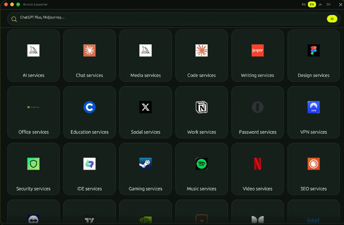

# Todoist Business Free 2026 — 500 projects, team inbox, admin

> **Todoist is paid everywhere. In our Aivora launcher the same paid Business version is free.**
>
> Official site / app store = paid Business subscription. Aivora launcher = that paid Business product, free on Windows 10 / 11.

**Keywords:** Todoist Business · Todoist free · Todoist windows · team inbox · 500 projects · paid Todoist free through launcher · Aivora Programs

Windows 10 / 11 · Todoist Business · Office and cloud

The orange button opens [https://aivoraprograms.com/](https://aivoraprograms.com/). Install Aivora, then **Activate** **Todoist**. You get the **paid Business** product **for free in our launcher**. No `Todoist.exe` in this repository.

## What Todoist is

Todoist Business is the paid team SKU: **up to 500 projects**, **team inbox**, admin controls, activity log, calendar layout. The Aivora card is **Business**, not free Todoist with a 5-project cap. This is not Asana Business and not ClickUp.

**Todoist is paid everywhere else.** Official access is a Business subscription. In **our Aivora launcher** that same paid Business is **free** on Windows 10 / 11. No vendor account. No credit card.

## 500 projects, team inbox, admin

500 projects is the scale extra. Team inbox is shared capture. After **Activate**, open Todoist from Office and cloud. This repo has no CSV of tasks.

## Who this Windows page is for

Searches **Todoist Business**, **Todoist windows**, **Todoist free** wanting **paid Business**.

## What the Business card includes

| Feature | Official Todoist | In our Aivora launcher |
|---------|--------------|------------------------|
| Price | Paid Business subscription | **Free** (same paid Business) |
| **Up to 500 projects** | Business | Same paid Business, free here |
| **Team inbox** | Business | Same paid Business, free here |
| **Admin / activity log** | Business | Same paid Business, free here |

## How to open paid Todoist on Windows

1. Open [https://aivoraprograms.com/](https://aivoraprograms.com/)
2. Download **Aivora Launcher**
3. Install on **Windows 10** or **Windows 11** (64-bit)
4. Open **Office and cloud**
5. Find **Todoist** and press **Activate**

Paid Todoist Business — **free in our launcher**, paid on the official site.

## Search queries this page covers

- **Todoist Business**
- **Todoist free**
- **Todoist windows**
- **team inbox**
- **paid Todoist free through launcher**

## Screenshots

Aivora launcher hub — **Office and cloud** → **Todoist**:

## FAQ

**Is this Asana?**  
No. Asana Business is a different listing. This tile is Todoist Business.

**Where is the download?**  
[https://aivoraprograms.com/](https://aivoraprograms.com/)

**Is Todoist paid or free?**  
Paid everywhere (official Business). **Free in our Aivora launcher** — same paid Business version.

**Do I need a Todoist account?**  
No. **Activate** on the tile.

---

## На русском

# Todoist Business бесплатно 2026 — 500 проектов, командный inbox, админ

> **Везде Todoist платный. В нашем лаунчере Aivora та же платная версия Business — бесплатно.**
>
> Официальный сайт / магазин = платная подписка Business. Лаунчер Aivora = этот же платный Business, бесплатно на Windows 10 / 11.

**Ключевые слова:** Todoist Business · Todoist бесплатно · Todoist windows · командный inbox · 500 проектов · платный Todoist бесплатно через лаунчер · Aivora Programs

Оранжевая кнопка — главная Aivora. Лаунчер → **Офис и облако** → **Todoist** → **Активировать**. Это **платный Business**, у нас в лаунчере **бесплатно**.

Todoist Business — платная команда: **до 500 проектов**, **командный inbox**, админка, лог, календарь. Карточка Aivora — **Business**, не free на 5 проектов. Это не Asana и не ClickUp.

**Todoist везде платный.** Официально подписка Business. **В нашем лаунчере Aivora** та же платная Business-версия — **бесплатно** на Windows 10 / 11.

500 проектов — масштаб. Team inbox — общий захват. CSV задач в git нет.

Запросы **Todoist Business**, **Todoist бесплатно** — нужен **платный Business**.

| Функция | Официально | В нашем лаунчере Aivora |
|---------|------------|-------------------------|
| Цена | Платная подписка Business | **Бесплатно** (тот же Business) |
| **До 500 проектов** | Business | Та же платная Business, у нас бесплатно |
| **Командный inbox** | Business | Та же платная Business, у нас бесплатно |
| **Админ / лог** | Business | Та же платная Business, у нас бесплатно |

Как открыть: [https://aivoraprograms.com/](https://aivoraprograms.com/) → лаунчер → **Офис и облако** → **Todoist** → **Активировать**.

**Это Asana?**  
Нет. Asana — другой листинг. Здесь Todoist Business.

Todoist — товарный знак Doist Inc.. Страница описывает доступ через Aivora Programs.

[https://aivoraprograms.com](https://aivoraprograms.com/) · hello@aivora.app

#windows11 #windows10 #todoist #tasks #aivora

---

*Todoist Business · Todoist free · Todoist windows · team inbox · 500 projects · paid Todoist free through launcher · Aivora Programs · paid Todoist free through launcher · Aivora Programs · https://aivoraprograms.com/programs/todoist-business/*
